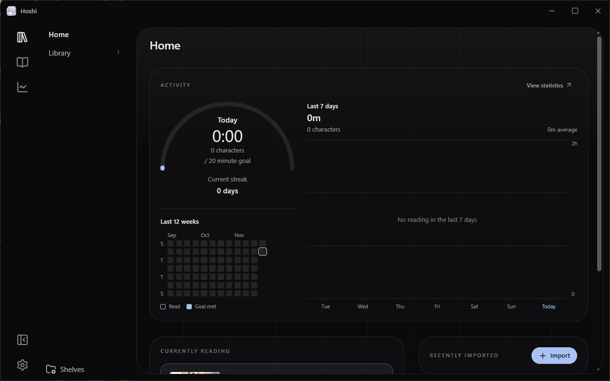
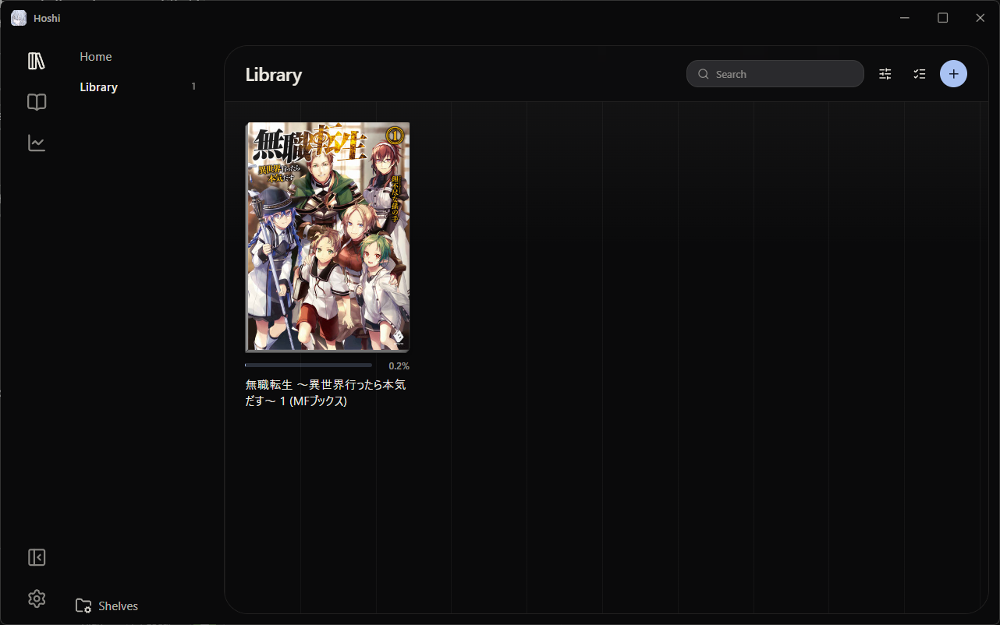
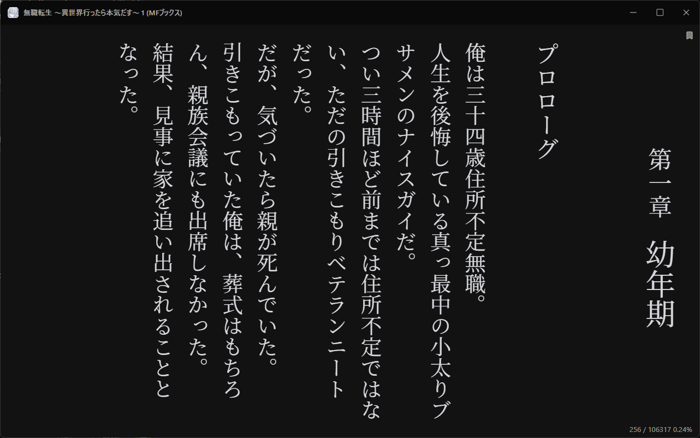
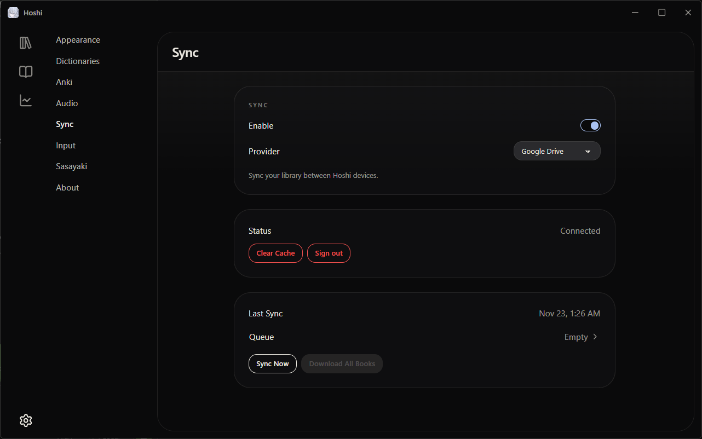

<div align="center">

# Hoshi


A desktop reader for Japanese books on Windows, built with Tauri and Svelte.

<p align="center">
  
  
  
  
</p>

</div>

## Download

[](https://github.com/tskmri/hoshi/releases/latest)

Download the `-setup.exe` installer for Windows 10/11 (64-bit), or build it yourself with the steps below.

## Features

- Vertical (縦書き) and horizontal (横書き) text with custom fonts, sizing and fullscreen reading
- Pop-up dictionary with support for Yomitan term, frequency, pitch and kanji dictionaries
- Audio support for local and remote sources
- Sasayaki (audiobook) playback with transcript matching
- Library with shelves, reading statistics and reading goals
- Mining using AnkiConnect (mainly supports the handlebars used by [Lapis](https://github.com/donkuri/lapis#how-to-use-lapis))
- Optional Google Drive sync of books, shelves, bookmarks, highlights, reading statistics and Sasayaki matches

## Recommended dictionaries

Settings → Dictionaries has a **Download Recommended Dictionaries** button that installs Jitendex and JMnedict (terms), Jiten (frequency) and KANJIDIC (kanji) in one step. It downloads `dicts.zip` from the [`dicts-v1`](https://github.com/tskmri/hoshi/releases/tag/dicts-v1) release asset (about 176 MB) and only adds dictionaries you do not already have, so re-running it is safe. The installers themselves stay small.

## Development

### Prerequisites

- Windows 10/11 (64-bit)
- [Rust](https://rustup.rs/) stable (see `rust-version` in `src-tauri/Cargo.toml`)
- [Node.js](https://nodejs.org/) 22.12+ and [pnpm](https://pnpm.io/) 11
- [CMake](https://cmake.org/) 3.24+
- Visual Studio 2022 with the *Desktop development with C++* workload and *C++ Clang tools for Windows*

### Run

```sh
pnpm install
pnpm tauri dev
```

### Build

```sh
pnpm tauri build
```

The installer and MSI are written to `src-tauri/target/release/bundle`.

### Releases and auto-update

The app checks `https://github.com/tskmri/hoshi/releases/latest/download/latest.json` on launch and whenever the window regains focus, then downloads and installs the update in passive mode (the installer runs with the usual progress bar, then the app restarts).

Update bundles must be signed. A keypair was generated into the gitignored `.tauri-signing/` folder; its public half is in `src-tauri/tauri.conf.json` (`plugins.updater.pubkey`). To let the release workflow sign artifacts, add the contents of `.tauri-signing/hoshi.key` as a repository secret named `TAURI_SIGNING_PRIVATE_KEY` (Settings → Secrets and variables → Actions).

Pushing a `hoshi-v*` tag (for example `hoshi-v1.0.1`) runs `.github/workflows/publish.yml`; it can also be started by hand from Actions → publish → Run workflow with the tag as input. The job builds the NSIS installer, signs it, and creates a **draft** release containing `latest.json`. Publish the draft — the updater only sees published releases. The `hoshi-v` prefix keeps fork releases apart from the upstream `v*` tags this repository was forked with.

Keep the private key: without it you cannot sign future updates, and clients on the current public key will reject anything else.

### Google Drive sync

Sync needs your own Google Cloud OAuth client. In the Google Cloud console, enable the **Google Drive API**, create an OAuth client, and register `http://127.0.0.1:42813` as an allowed redirect URI.

Then create a `.env` file in the project root:

```sh
HOSHI_GOOGLE_CLIENT_ID=your-client-id
HOSHI_GOOGLE_CLIENT_SECRET=your-client-secret
```

`src-tauri/build.rs` reads these at compile time and bakes them into the binary, so rebuild after changing them. `.env` is gitignored and no credentials belong in the repository.

In the app, open **Settings → Sync**, enable sync and sign in with the account whose Drive should hold the library. Data is written to a `Hoshi` folder in that account's Drive (`Hoshi/books` for EPUBs, covers and Sasayaki matches, `Hoshi/state` for the synced reading state).

## Libraries

| Name | License |
| :--- | :--- |
| [hoshidicts-rs](https://github.com/Manhhao/hoshidicts-rs) | GPL-3.0 |
| [Tauri](https://github.com/tauri-apps/tauri) | Apache-2.0 / MIT |
| [Svelte](https://github.com/sveltejs/svelte) | MIT |
| [rbook](https://github.com/DevinSterling/rbook) | Apache-2.0 |
| [mp3lame-encoder](https://github.com/DoumanAsh/mp3lame-encoder) | LGPL-3.0 |
| [opus](https://github.com/SpaceManiac/opus-rs) | MIT / Apache-2.0 |
| [ogg](https://github.com/RustAudio/ogg) | BSD-3-Clause |
| [rubato](https://github.com/HEnquist/rubato) | MIT / Apache-2.0 |
| [Tailwind CSS](https://github.com/tailwindlabs/tailwindcss) | MIT |
| [daisyUI](https://github.com/saadeghi/daisyui) | MIT |
| [Lucide](https://github.com/lucide-icons/lucide) | ISC |

## Attribution

| Name | Description | License |
| :--- | :--- | :--- |
| [Hoshi Reader Desktop](https://github.com/Manhhao/Hoshi-Reader-Desktop) | Desktop app this project is based on | GPL-3.0 |
| [Hoshi Reader](https://github.com/Manhhao/Hoshi-Reader) | Original iOS app | GPL-3.0 |
| [Hoshi Reader Android](https://github.com/HuangAntimony/Hoshi-Reader-Android) | Android app | GPL-3.0 |
| [Ankiconnect Android](https://github.com/KamWithK/AnkiconnectAndroid) | Implementation for local audio database | GPL-3.0 |
| [Yomitan](https://github.com/yomidevs/yomitan) | Various code from pop-up dictionary | GPL-3.0 |
| [@i_am_onizame](https://x.com/i_am_onizame/status/2074108413546807451) | Artwork | |
| [Jitendex](https://github.com/Stepney141/Jitendex) | Bundled term dictionary | CC BY-SA 4.0 |
| [JMdict and JMnedict](https://www.edrdg.org/) | Bundled term dictionaries | CC BY-SA 4.0 |
| [KANJIDIC2](https://www.edrdg.org/) | Bundled kanji dictionary | CC BY-SA 4.0 |

## License

Distributed under the GNU General Public License v3.0. See [LICENSE](LICENSE) for more information.
